<h1 align="center">BigLinux Welcome</h1>

<p align="center">
  <strong>Guided setup and feature discovery for <a href="https://www.biglinux.com.br">BigLinux</a></strong>
</p>

<p align="center">
  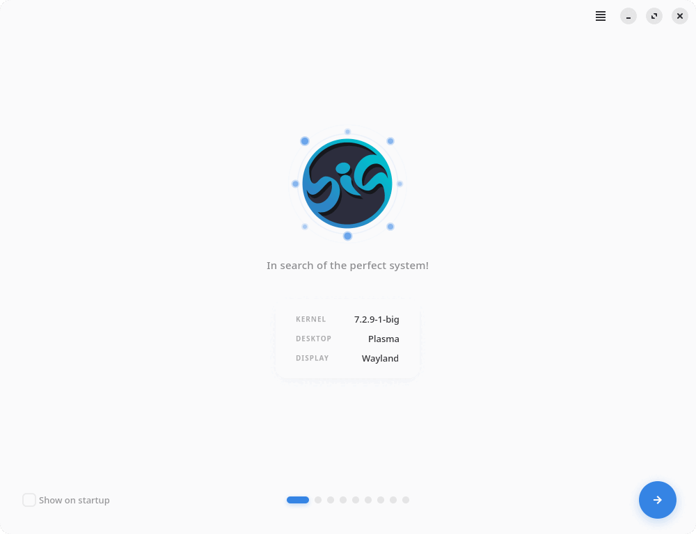
</p>

<p align="center">
  
  <a href="https://github.com/ruscher/biglinux-welcome/actions/workflows/tests.yml"></a>
  
  
  
  
  
</p>

<p align="center">
  <a href="#features">Features</a> •
  <a href="#screenshots">Screenshots</a> •
  <a href="#installation">Installation</a> •
  <a href="#how-installing-applications-works">Installing applications</a> •
  <a href="#development">Development</a> •
  <a href="#troubleshooting">Troubleshooting</a> •
  <a href="#authors-and-maintainers">Authors</a>
</p>

---

## About

**BigLinux Welcome** opens on the first login of a new BigLinux system. In a few pages it helps the user configure the desktop, choose a default browser, reach the hardware tools, discover the applications made for BigLinux, install new ones safely and connect with the community — through a native GTK 4 / libadwaita interface that follows the system theme, accent color and language.

## Features

- **Guided pages** defined in a single `pages.yaml`: initial settings, default browser, KDE Connect, drivers and hardware, family safety, BigLinux features, applications to install, community and donations.
- **Default browser** — shows installed browsers and the current default; sets a new default; installs browsers available in the configured repositories, with real progress.
- **Hardware Management** — one entry for the unified drivers and kernels manager (`big-driver-manager`), next to BigLinux Info, Network Info and Printers.
- **Applications to Install** — Big Game Mode, Big Remote Play, BigCam, ChatAI, BigLinux Body Tracker and Big Advogados, each with its real status (installed, not installed, installing, failed, unavailable) and one main action.
- **Safe installations** — allowlisted packages, a transaction preview before any password prompt, Polkit authentication, one pacman transaction at a time, no partial upgrades, cancellation, verification after installing.
- **Launchers that explain themselves** — if a tool is missing, the card says so and offers to install it when it is available.
- **About dialog** (main menu) with version, authors, website and issue tracker.
- **Autostart control** — the “Show on startup” switch masks/unmasks the systemd user service.
- **Accessible** — keyboard navigation (Tab, Alt+←/→, Ctrl+Q), visible focus, names, descriptions and headings for screen readers, high-contrast and reduced-motion support.
- **Responsive and sharp** — card grids wrap on narrow windows; SVG icons are rendered at the monitor scale (100%–200%, fractional included).
- **32 locales**, with English fallback.

### What's new in 3.0.1

- **ChatAI** now works like in BigLinux Settings: installing it also adds it to every panel; installed versions are detected and offered as an update. It now comes from the maintained [CommunityBigLinux/ChatAI-Plasmoid](https://github.com/CommunityBigLinux/ChatAI-Plasmoid) (version 1.0.1), synced into biglinux/ChatAI-Plasmoid.
- **Application cards keep their size** in every state — installing, progress and error messages all fit inside the card.
- Licensed as **GPL-3.0-or-later**, with a LICENSE file.

### What's new in 3.0.0

- New **Applications to Install** page and a shared, secure installation backend (also used by the browser page and by launchers).
- **Hardware Management** replaces *Driver Manager* and *Kernel Manager*; **Text Narrator** (`biglinux-tts`) replaces *Configure voice* (`tts-config`); **Noise Reduction** now opens `biglinux-microphone` — the old commands no longer exist.
- Applications can be **pinned to a repository** (the Body Tracker and Big Advogados always come from `biglinux-stable`).
- **Faster startup**: pages are built when first shown and package queries run only on the pages that need them.
- Fixes: duplicate windows on a second launch, crash with a non-generated `LANG`, partial upgrades and `yay` as root in the old browser installer, blurry icons on HiDPI, untranslated progress messages, and more.
- About dialog, `--version`, Polkit policy, test suite with CI, `update-translations.sh`.

## Screenshots

| | |
|:---:|:---:|
| 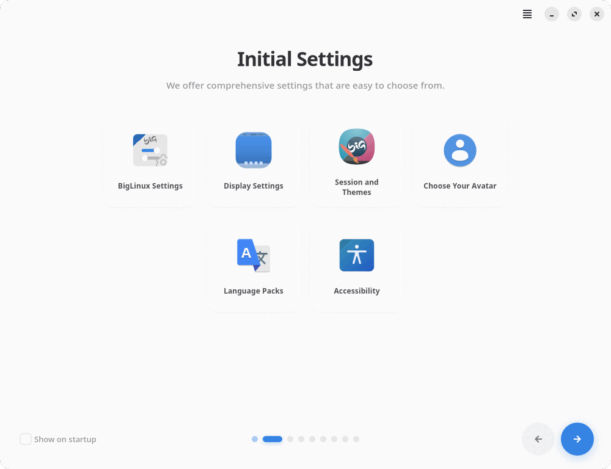 | 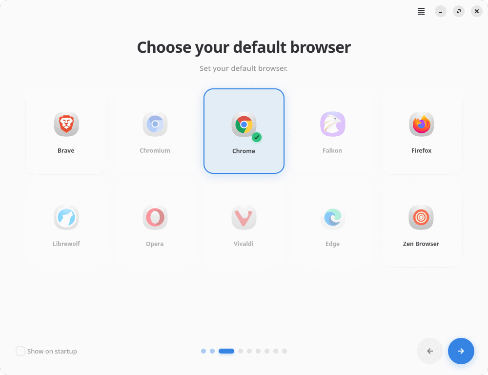 |
| *Initial settings* | *Default browser* |
| 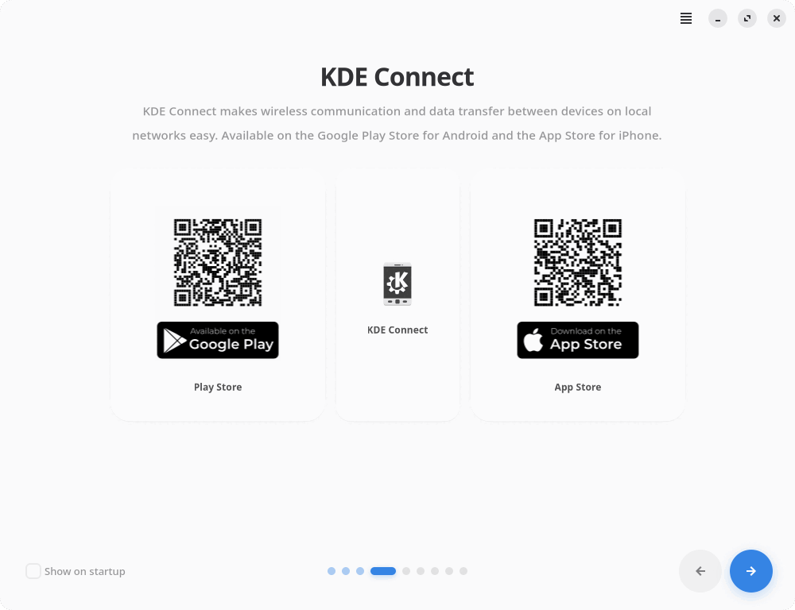 | 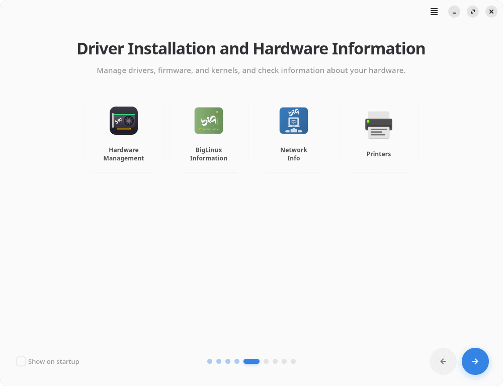 |
| *KDE Connect* | *Drivers and hardware* |
| 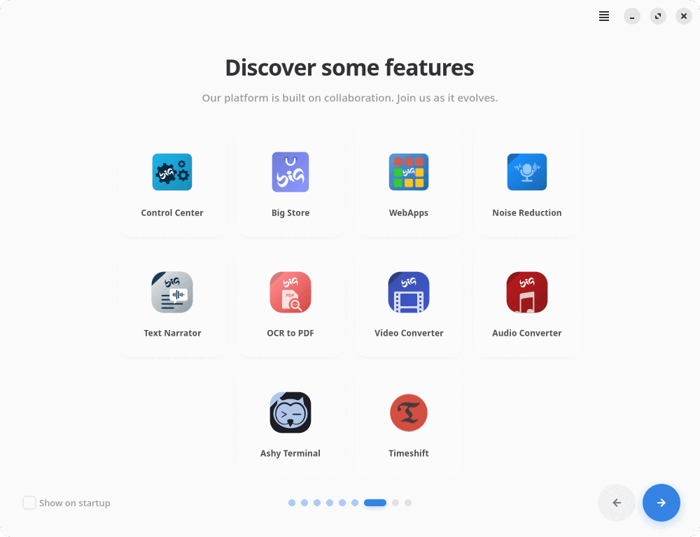 | 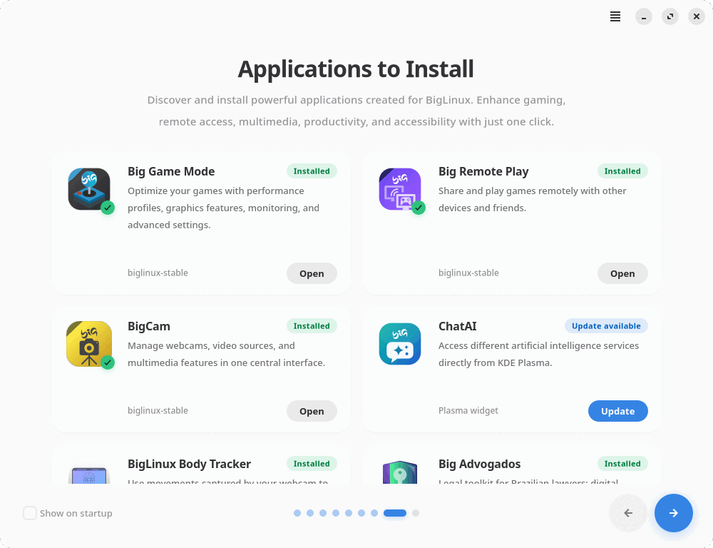 |
| *BigLinux features* | *Applications to Install* |
| 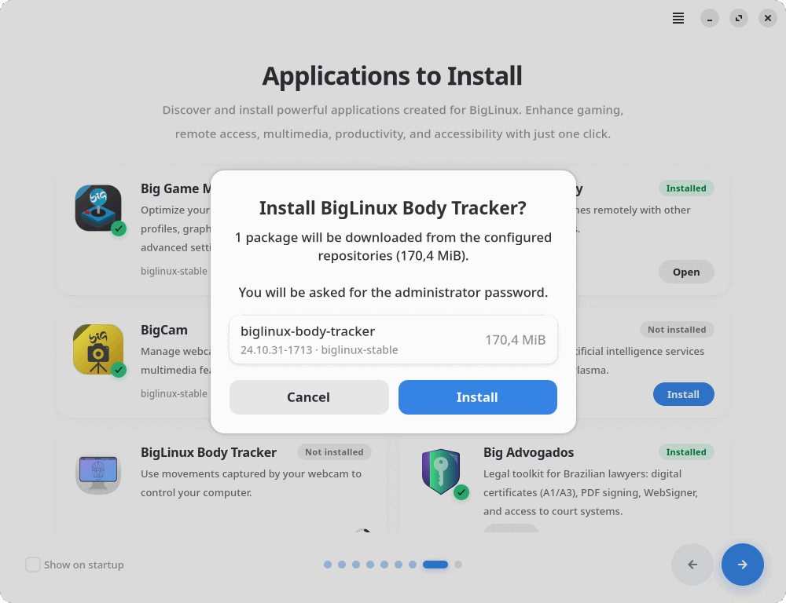 |  |
| *Confirmation with the real transaction preview* | *Dark theme, Brazilian Portuguese* |
| 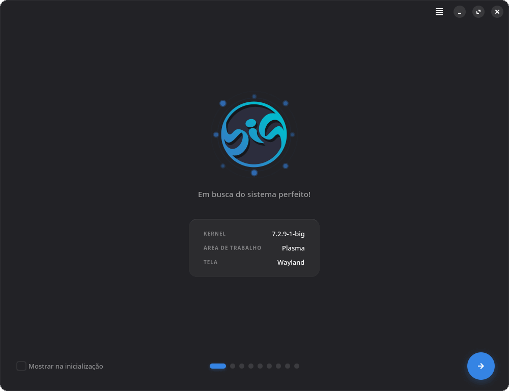 | 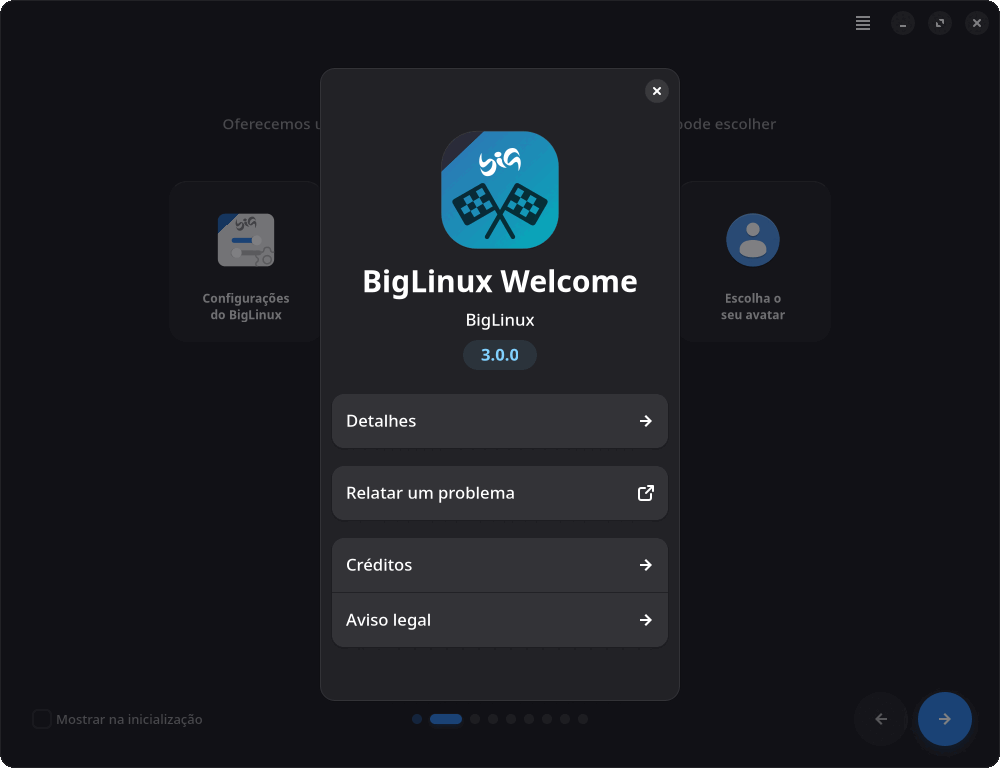 |
| *Start page, dark theme* | *About dialog* |

<p align="center">
  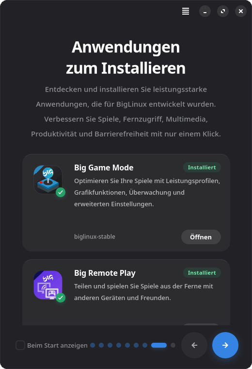<br>
  <em>Narrow window, German</em>
</p>

All screenshots are real renders of version 3.0, made with GTK's headless Broadway backend on a BigLinux system.

## Requirements

- An Arch-based system; BigLinux with **KDE Plasma 6** for the full experience (the application runs on any desktop — Plasma-only items explain that they need Plasma).
- Wayland or X11.
- Python ≥ 3.12, GTK 4, libadwaita ≥ 1.7.

### Dependencies

All dependencies are in the official Arch Linux repositories — no extra repository is needed to build or install the package.

| Package | Purpose |
|---------|---------|
| `gtk4`, `libadwaita` | User interface |
| `python`, `python-gobject`, `python-cairo` | Runtime and bindings |
| `python-yaml` | Page configuration |
| `polkit` | Authentication for installations |
| `pacman` | Package queries and installation |
| `xdg-utils` | Default browser |
| `hicolor-icon-theme` | Application icon |
| `kpackage` *(optional)* | `kpackagetool6`, to install the ChatAI widget |
| `git` *(build only)* | Fetching the sources |

The BigLinux tools opened by the cards (Big Store, Control Center, Hardware Management, …) are **not** dependencies: when one is missing the card explains it, and offers to install it if it is available in the configured repositories.

## Installation

### From the BigLinux repositories

```bash
sudo pacman -S biglinux-welcome
```

### Building with the PKGBUILD

```bash
git clone https://github.com/ruscher/biglinux-welcome.git
cd biglinux-welcome/pkgbuild
makepkg -si
```

`makepkg` clones the published repository. To package **your working copy** (including uncommitted changes) instead:

```bash
cd biglinux-welcome/pkgbuild
BIGLINUX_WELCOME_SRC="$(realpath ..)" makepkg -sif
```

Run `makepkg` as a normal user, never as root. Only `usr/` is packaged; development caches are removed and `docs/` and `tests/` are not installed.

The package version is `1:3.0.1-1`. The epoch makes it newer than the earlier date-based builds (for example `26.10.10-0348`), so existing installations upgrade normally.

### Running

```bash
biglinux-welcome                  # open the assistant
biglinux-welcome --start-page 7   # open a given page (7 = Applications to Install)
biglinux-welcome --version
```

On BigLinux the *bigcontrolcenter* pacman hook moves the menu entry into the Control Center, so the Welcome is opened from there (or by the command above).

## How installing applications works

The browser page, the Applications page and the launcher cards share one implementation (`install_backend.py` + `install_flow.py`):

1. **Checks before any password** — another installation running, no network, package database locked.
2. **Preview** — `pacman -Sp --needed` (read-only, as the user) lists every package to download, with versions, repositories and sizes; missing packages and unresolvable dependencies are reported here.
3. **Confirmation** — the user sees that list and the download size (plus a warning if the package lists are older than 14 days).
4. **Authentication** — `pkexec` runs `scripts/package-install.sh` (Polkit action `org.biglinux.welcome.install-packages`).
5. **Installation** — the helper accepts only allowlisted packages, optionally pinned to an allowlisted repository, and runs `pacman -S --needed -- [repository/]package`. Output feeds the progress bar and the log; cancelling sends SIGINT to pacman until it starts changing files.
6. **Verification** — success is reported only after `pacman -Q` confirms the package.

Security rules:

- No `pacman -Sy` (partial upgrades). If the mirrors no longer have the files because the package lists are outdated, the user can choose **Update and Install** (`pacman -Syu --needed package`) after a separate confirmation.
- Package names and repositories are validated and allowlisted in **both** `install_backend.py` and the privileged helper (a test keeps the lists identical). No shell is involved in building commands.
- One pacman transaction at a time; closing the window during an installation asks for confirmation, and pacman keeps running safely if the window is closed anyway.
- No `curl | sh`, no repositories added, no AUR builds as root. Browsers that only exist in the AUR (Chrome, Opera, Edge) are shown as unavailable and the user is pointed to Big Store.
- **ChatAI** is a Plasma widget without a package: it is downloaded over HTTPS from a pinned commit of [biglinux/ChatAI-Plasmoid](https://github.com/biglinux/ChatAI-Plasmoid) (kept in sync with [CommunityBigLinux/ChatAI-Plasmoid](https://github.com/CommunityBigLinux/ChatAI-Plasmoid)), checked against a SHA-256 of all its files, validated, installed for the current user with `kpackagetool6` — no administrator password — and added to the panels, as BigLinux Settings does.

### Applications offered

| Application | Installed from | Opens with |
|-------------|----------------|------------|
| Big Game Mode | `bigame-mode` | `bigame-ui` |
| Big Remote Play | `big-remote-play` | `big-remote-play` |
| BigCam | `bigcam` | `bigcam` |
| ChatAI | Plasma widget `ChatAI-Plasmoid` (version 1.0.1) | Added to every panel when installed |
| BigLinux Body Tracker | `biglinux-stable/biglinux-body-tracker` | `big-head-tracker` |
| Big Advogados | `biglinux-stable/big-advogados` | `big-advogados` |

To offer another application: add the package to `ALLOWED_PACKAGES` in `install_backend.py` **and** in `scripts/package-install.sh`, add an entry to the `page_type: "apps"` page of `pages.yaml` (`label`, `description`, `icon`, `package`, `command`, optionally `repository`), put its SVG in `image/applications/` and run `./update-translations.sh`.

## KDE Plasma integration

- Settings cards open Plasma modules (`systemsettings`, `kcmshell6`) and BigLinux tools.
- **ChatAI** works like in BigLinux Settings: **Install** downloads and installs the widget and then adds it to every panel that does not have it yet (widgets are unlocked for the change and the previous lock state is restored). The card shows *Installed* once Plasma reports the widget on a panel, *Update available* when another version is installed (**Update** upgrades and re-applies it), and *Add to Panel* if it was removed from the panels.
- Launched applications receive a startup-notification / Wayland activation token, so their windows open in front.
- Single instance: launching the Welcome again (from the menu or the autostart service) brings the existing window forward.

## Project structure

```
biglinux-welcome/
├── usr/
│   ├── bin/biglinux-welcome                 # launcher
│   ├── lib/systemd/user/biglinux-welcome.service
│   └── share/
│       ├── applications/org.biglinux.welcome.desktop
│       ├── biglinux/welcome/
│       │   ├── main.py                      # entry point, gettext setup, --version
│       │   ├── app.py                       # Adw.Application, CSS, About dialog
│       │   ├── window.py                    # window, navigation, browser page
│       │   ├── apps_page.py                 # Applications to Install
│       │   ├── install_flow.py              # checks → preview → confirmation → job
│       │   ├── install_backend.py           # package queries, install jobs, ChatAI widget
│       │   ├── widgets.py                   # shared widgets
│       │   ├── utils.py                     # constants, icons, pages.yaml loading
│       │   ├── style.css
│       │   ├── pages.yaml                   # page definitions
│       │   ├── translatable_strings.py      # generated from pages.yaml
│       │   ├── scripts/package-install.sh   # privileged, allowlisted pacman helper
│       │   ├── scripts/browser.sh           # get/set the default browser
│       │   └── image/                       # SVG icons per page
│       ├── polkit-1/actions/org.biglinux.welcome.policy
│       ├── icons/hicolor/scalable/apps/biglinux-welcome.svg
│       └── locale/                          # compiled translations (.mo)
├── locale/                                  # .po catalogs and the .pot template
├── pkgbuild/                                # PKGBUILD and install hooks
├── tests/                                   # test suite
├── docs/screenshots/
├── LICENSE                                  # GPL-3.0-or-later
├── generate_strings.py                      # extracts strings from pages.yaml
└── update-translations.sh                   # refreshes .pot/.po/.mo
```

## Internationalization

32 locales: Belarusian, Bulgarian, Czech, Danish, German, Greek, English, Spanish, Estonian, Finnish, French, Hebrew, Croatian, Hungarian, Icelandic, Italian, Japanese, Korean, Dutch, Norwegian, Polish, Portuguese, Brazilian Portuguese, Romanian, Russian, Slovak, Swedish, Turkish, Ukrainian and Chinese (generic, Simplified and Traditional). Every catalog is complete and checked with `msgfmt --check`; untranslated strings fall back to English.

All source strings are in English: page texts from `pages.yaml` (`title`, `subtitle`, `label`, `description`) and code strings (`_()`, `N_()`, `ngettext()`). After changing strings:

```bash
./update-translations.sh
```

It regenerates `translatable_strings.py` and `locale/biglinux-welcome.pot`, merges new strings into every `locale/*.po` (existing translations are kept) and compiles the `.mo` files. New strings stay empty until translated; the BigLinux build pipeline also fills them automatically. The pt-BR texts were written by hand; reviews of the other languages by native speakers are welcome.

## Development

```bash
cd usr/share/biglinux/welcome
python main.py
```

### Tests and checks

```bash
python -m pytest tests/ -v            # GUI tests run when a display is available
tests/run-headless.sh -v              # everything, on GTK's headless Broadway backend
RUN_NETWORK_TESTS=1 python -m pytest tests/test_installer.py -k chatai   # pinned ChatAI download

ruff check usr/share/biglinux/welcome tests generate_strings.py
ruff format --check usr/share/biglinux/welcome tests generate_strings.py
shellcheck usr/share/biglinux/welcome/scripts/*.sh update-translations.sh tests/run-headless.sh
```

The suite checks the page configuration, translations, version consistency and the installer: it runs the **real privileged helper**, unprivileged, against a fake `pacman` and `pkexec` (success, network failure, locked database, cancellation reaching pacman, Polkit dismissed/denied, verification, pinned repositories), installs ChatAI into a private package root (including tampered and path-traversal archives) and drives the real widgets. GitHub Actions (`.github/workflows/tests.yml`) runs all of this in an `archlinux` container with ruff 0.17.0.

## Troubleshooting

| Problem | What to do |
|---------|------------|
| A card says *Unavailable* | The package is not in the repositories configured in `/etc/pacman.conf` (or its database is old). Update the system and reopen the page. |
| *The package lists are out of date…* | Choose **Update and Install**, or run `sudo pacman -Syu` and try again. |
| *Another program is using the package manager* | Wait for the other update/installation to finish. A stale `/var/lib/pacman/db.lck` left by a crash can be removed once no package manager is running. |
| ChatAI says *Requires KDE Plasma* | The widget only works in a KDE Plasma session; install `kpackage` for `kpackagetool6`. |
| The Welcome no longer opens at login | Check **Show on startup**, or run `systemctl --user unmask biglinux-welcome.service`. |
| Installation details | The full pacman output is in the *Details* view and in `/var/log/biglinux-welcome.log`. |

## Authors and maintainers

- **Rafael Ruscher**
- **Bruno Gonçalves**
- **Barnabé Di Kartola**

ChatAI-Plasmoid is developed by its own authors and is downloaded from its repository, not bundled. Application icons belong to their respective BigLinux projects.

## License

BigLinux Welcome is free software, distributed under the **GNU General Public License, version 3 or (at your option) any later version** (`GPL-3.0-or-later`). See [LICENSE](LICENSE).

## Links

- 🌐 [biglinux.com.br](https://www.biglinux.com.br)
- 💬 [Forum](https://forum.biglinux.com.br)
- 📺 [YouTube](https://www.youtube.com/@BigLinuxx)
- ✈️ [Telegram](https://t.me/biglinux)
- ❤️ [Donate](https://www.biglinux.com.br/doacao-financeira/)
- 🐞 [Issues](https://github.com/ruscher/biglinux-welcome/issues)
